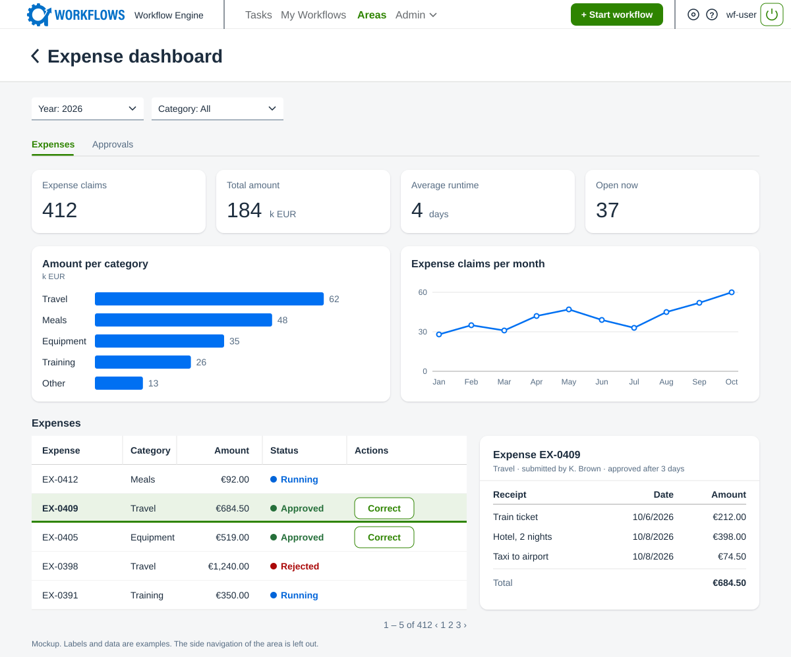
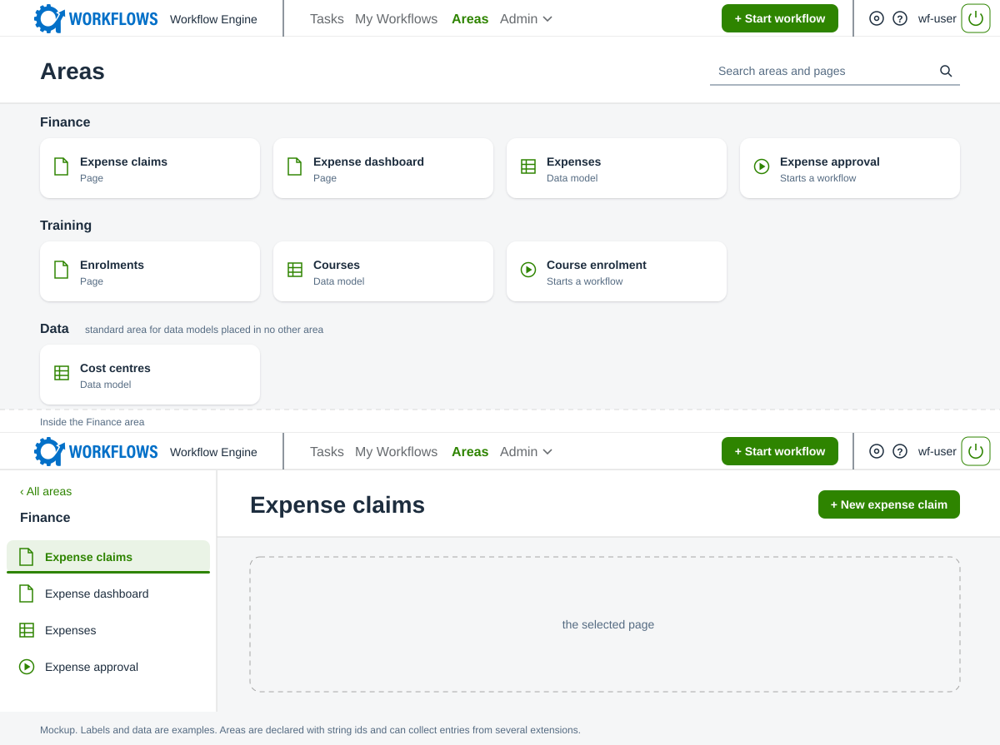
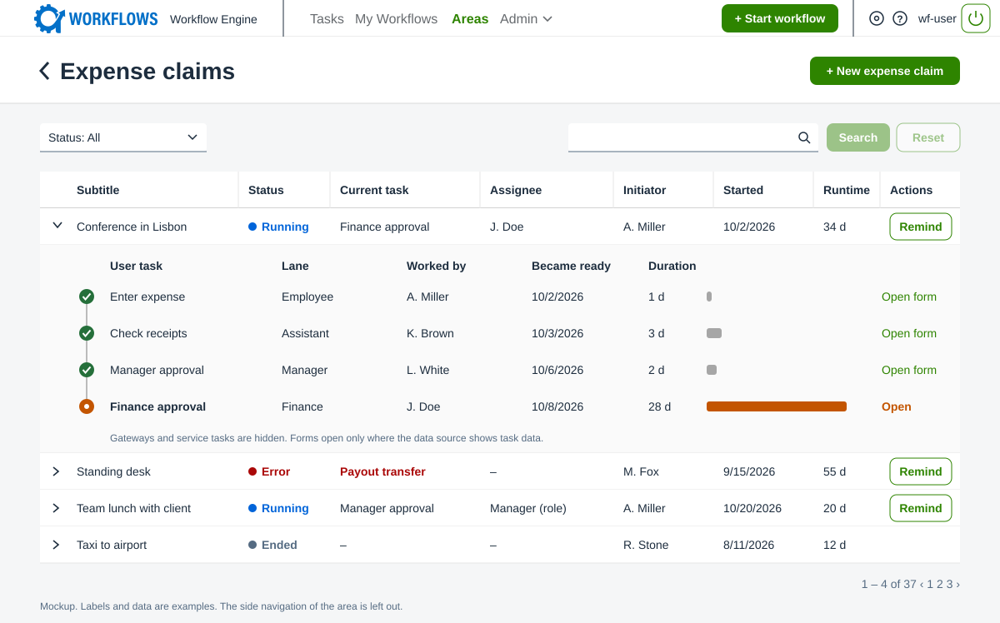

# ADR 015: Overview Pages Defined by Extensions

**Status:** Proposed
**Date:** 2026-11-05

## Context

Those responsible for workflows have different needs when it comes to evaluating workflow data, depending on their domain. Some only want an overview of the records that workflows created, and to start follow-up workflows from them. Others want to analyse the data entered in the workflows in depth, to find where a workflow can be improved.

No page built into the engine can be precise enough for one of these needs and flexible enough for all of them. The engine therefore needs a framework in which such pages are defined, not another fixed page.

The data for such pages is also hard to query today. Which task ran when and by whom sits in internal tables that can change with any release. What was entered sits in the task data, which the database cannot query. It only reaches a column when a service task writes it into a data model ([ADR 004](adr_004_data_entity_persistence.md)), and that has to be built into every workflow.

## Decision Drivers

1. An extension builds the pages its domain needs, without frontend code and without a change to the engine.
2. The developer of the extension decides who may open a page and which data each user sees.
3. Derived data must not contradict its workflow instance. The database enforces this wherever it can.
4. Derived data covers existing workflow instances, not only new ones.

## Decision

### Pages

**An overview page is a Python function that an extension registers.** The registration names the roles that may open the page and the data sources it uses. The engine ships the blocks and renders every page generically. It ships no pages.

**The function describes the page by calling blocks.** An input returns its current value, so the code that follows can depend on it. A table returns the key of the selected row.

**The backend keeps no state for a page.** The frontend holds the input values in the URL. When one changes, the backend runs the function again and answers with the whole page.

*Mockup of a page. The selected row drives the detail on the right.*

### Menu

**Extensions fill the menu through areas.** An area groups the entries of one domain. It is declared once with a string id, and any extension can add entries to it by that id. An entry is a page, a data model ([ADR 006](adr_006_data_model_rest_api.md)) or the start of a workflow. Declarations with the same id are merged, and the engine logs a warning where they disagree.

**The areas become one item in the menu.** It replaces today's Data item, and the other items stay. A data model that no area lists appears in a standard area.

*Mockup of the menu: the top bar, the areas overview and the side navigation of one area.*

### Data sources and access

**All data on a page comes from data sources.** A data source is a function that an extension registers. It receives the requesting user and parameters, such as the key of a selected row, and returns a query. The developer writes into that query which rows and columns this user gets.

**A table carries a reference to its data source, never the rows.** The frontend fetches the rows separately. The backend runs the data source for the requesting user and does paging, sorting and search in the database, with the table mechanics the engine already has. Paging or sorting therefore reloads only the rows, not the page. Key figures and charts ask a data source for aggregates.

**Access is declared with the page.** The roles of a page decide who may open it, and its data sources decide what each user sees.

**A data source names what it reads.** If every data source could read any workflow and any table, nobody could tell later which page depends on which data, and a change to one workflow could break pages unnoticed. A data source therefore declares the workflows and derived tables it reads, and whether it shows task data. The engine gives it access to nothing else. Workflows already declare the data models they use in the same way.

**A page can start workflows, and changes nothing else.** A data source declares follow-up workflows for its rows, as a data model does (ADR 006). A start without a row is a block on the page or an entry in the menu. No block runs code of the extension on a click.

### Workflow views and projections

**Facts about the run are read through workflow views.** A data source needs to know, for example, the status of a workflow instance, its open user task and who worked on which task when. This sits in the engine's internal tables, which a data source must not query, because they change between releases. The engine therefore provides two database views with stable columns: one of workflow instances and one of their user tasks. A view is a stored query, so it copies nothing and cannot drift.

**Business facts are derived by a projection.** An extension registers a function for a workflow. It receives the stored state of one workflow instance and returns rows that describe it. The rows go into derived tables, which the extension owns and migrates ([ADR 005](adr_005_extension_database_migrations.md)). Aggregates such as monthly or yearly values are not stored. Data sources compute them from the derived tables when a page asks.

**The derivation runs in the backend, and the database guards the result.** The engine runs the projection whenever it stores a workflow instance and writes the rows in the same transaction. A foreign key ties every derived row to its workflow instance.

**A failing projection fails the request.** Neither the workflow instance nor the rows are stored.

**A projection is a pure function of the stored state.** The engine can therefore run it again for every workflow instance. It does so in the background when a projection is new or was changed. Unlike a request, this rebuild does not stop at a failure: it skips the workflow instance and reports it.

**A projection has to cope with missing data.** Older workflow instances may lack fields that were added later. Their columns stay empty, which means not recorded.

*Writing and reading derived data. Blue parts belong to the engine, green parts to the extension.*

### Page building blocks

**The engine ships a small set of basic blocks.**

- Inputs, such as a selection, a text or a date.
- Tables, which show the rows of a data source with paging, sorting and search. A table also offers the follow-up workflows of each row.
- Key figures and charts, which show aggregates of a data source. The chart types are few and fixed, for example bars and lines.
- Layouts, such as tabs and columns.
- The start of a workflow, as a button.
- The read-only form of a completed user task.

**Blocks can be combined into reusable components.** A component is an ordinary function that calls blocks. An extension can write its own and use them on several pages, and the engine ships some as well.

**Example: The course of a workflow instance is such a component.** It shows the user tasks the workflow instance reached, who worked on each and how long each took. Where the data source shows task data, a completed user task opens as a read-only form. A page uses it like a block, for example for the selected row of a table.

*Mockup of a page with a table of workflow instances and the course of the selected one.*

## Considered Alternatives

- **A fixed overview page in the engine.** The smallest step, but every further domain would need a change to the engine.
- **More declared blocks on the Data page.** It reuses what exists, but workflows without a data model would get no page.
- **A backend session per browser tab.** It gives the developer state between runs, but that state is lost with every deploy.
- **A separate reporting database.** It needs little work in the engine, but the engine's access rules do not apply to it.
- **Access declared in the BPMN model.** It would be visible at the workflow, but a page can read several workflows, and a model cannot express which rows a user sees.
- **Deriving business facts in the database.** Consistent by construction, but the rules of every extension would sit on the engine's tables.
- **A service task in each workflow writes the rows.** It needs nothing new, but existing workflow instances would have no rows.
- **A failing projection only marks its rows as stale.** A bug would not stop a workflow, but pages would show wrong numbers.

## Consequences

The frontend needs a generic renderer, and the menu moves from the frontend into the backend. Pages, data sources and projections run often and have to stay cheap.

Access is in the developer's hands, and so is the risk. A data source that narrows wrongly shows data to the wrong user, and the engine cannot detect that.

A bug in a projection blocks every change to the affected workflow instances until it is fixed, also an assignment or a cancellation. While a rebuild runs, pages show old and new rows side by side.

The workflow views need two things the engine does not record today: when a user task became ready, and whether a workflow instance was cancelled. Durations therefore exist only for user tasks that became ready after this is built.

